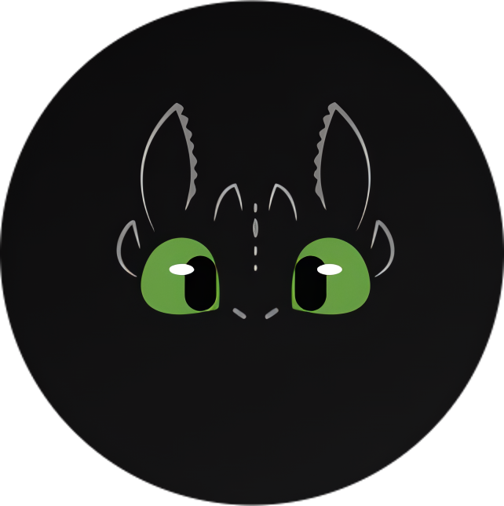
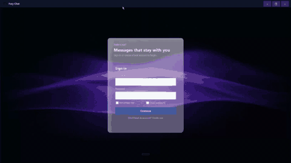
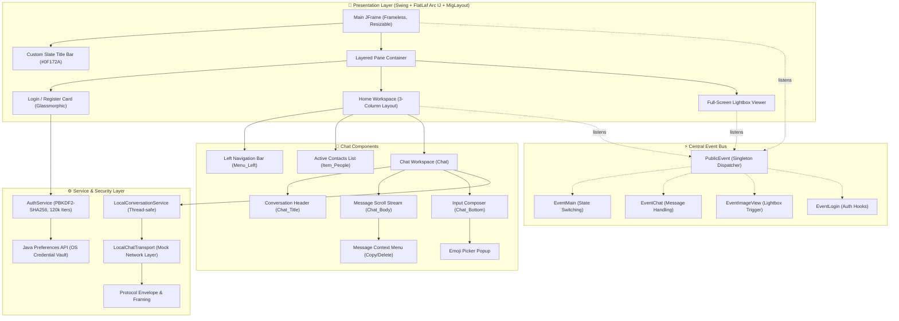

<div align="center">

  

  # ⚡ Fury Chat
  ### *A State-of-the-Art, Glassmorphic Desktop Chat Client Built with Java Swing*

  [](https://www.oracle.com/java/)
  [](https://www.formdev.com/flatlaf/)
  [](http://www.miglayout.com/)
  [](https://en.wikipedia.org/wiki/PBKDF2)
  [](https://github.com/Nafiz-365/Java-Chat-Application)
  [](LICENSE)

  <p align="center">
    <b>Fury Chat</b> is an advanced desktop instant messaging application that combines modern <b>frosted glassmorphism UI</b>, a frameless window system, decoupled event-driven architecture, and desktop communication features into a secure, responsive Java Swing client.
  </p>

</div>

## 🎥 Demo / Screencast

<p align="center">
  
</p>

---

## 📑 Table of Contents

- [🎥 Demo / Screencast](#-demo--screencast)
- [🏛️ Overview & Architecture](#️-overview--architecture)
- [🚀 Comprehensive Features Deep-Dive](#-comprehensive-features-deep-dive)
  - [1. Modern Glassmorphism & Frameless UI Engine](#1-modern-glassmorphism--frameless-ui-engine)
  - [2. Native OS & Taskbar Integration](#2-native-os--taskbar-integration)
  - [3. Military-Grade Local Authentication & Session Management](#3-military-grade-local-authentication--session-management)
  - [4. Three-Column Desktop Workspace](#4-three-column-desktop-workspace)
  - [5. Rich Interactive Chat Stream](#5-rich-interactive-chat-stream)
  - [6. Smart Message Composer & Attachments](#6-smart-message-composer--attachments)
  - [7. Lightbox Image Viewer](#7-lightbox-image-viewer)
  - [8. Protocol & Network-Ready Transport Layer](#8-protocol--network-ready-transport-layer)
- [🛠️ Technology Stack & Dependencies](#️-technology-stack--dependencies)
- [📂 Complete Package & File Breakdown](#-complete-package--file-breakdown)
- [🏁 Getting Started & Installation](#-getting-started--installation)
  - [Prerequisites](#prerequisites)
  - [1. Running Directly with Pre-built JAR](#1-running-directly-with-pre-built-jar)
  - [2. Building from Source (Terminal / CLI)](#2-building-from-source-terminal--cli)
  - [3. Building with Apache Ant](#3-building-with-apache-ant)
  - [4. Importing into IDEs](#4-importing-into-ides)
- [⌨️ Keyboard Shortcuts](#️-keyboard-shortcuts)
- [🗺️ Roadmap & Future Milestones](#️-roadmap--future-milestones)
- [👤 Author & Credits](#-author--credits)

---

## 🏛️ Overview & Architecture

Fury Chat is engineered around a clean, decoupled **Event-Driven Architecture (EDA)** where UI controllers, state repositories, and presentation widgets communicate through a central singleton event dispatcher (`PublicEvent`). This ensures complete separation of concerns and facilitates seamless future network backend integration. The desktop client is intentionally **offline-first**: authentication and conversation services run entirely locally with no backend dependency.

### System Architecture Diagram



---

## 🚀 Comprehensive Features Deep-Dive

### 1. Modern Glassmorphism & Frameless UI Engine
- **Multi-Layered Glass Rendering (`RoundedPanel`)**: Custom Java2D painting engine generating **6 distinct layers** when `glassy` mode is active:
  1. *Translucent Base*: 30-alpha white fill creating optical depth behind the panel background.
  2. *Background Body Fill*: Solid background color paint providing the frosted-glass body.
  3. *Top Shimmer Gradient*: 90→8 alpha white gradient across the top ~45% of the panel to simulate light reflection on polished glass.
  4. *Bottom Inner Glow*: 0→22 alpha white gradient along the bottom half for a subtle upward luminance.
  5. *Left Specular Highlight Strip*: Horizontal 55→0 alpha gradient across the left 8% of width, simulating a direct-light specular edge.
  6. *Glassy Border*: 110-alpha outer border + 35-alpha 1px inner border, replicating a frosted beveled glass edge.
- **Frameless Window Chrome**: `setUndecorated(true)` window styled with an ultra-dark slate title bar (`#0F172A` / RGB 15, 23, 42).
- **Smooth Window Dragging**: Custom `MouseMotionListener` on the title bar allowing the window to be dragged smoothly across displays.
- **Double-Click Title Bar Action**: Double-clicking the title bar toggles between maximized and normal window states.
- **Custom-Engineered Window Controls**:
  - Minimize (`−`): Minimizes smoothly to system taskbar via `setState(JFrame.ICONIFIED)`.
  - Maximize/Restore (`□` / `❐`): Intelligently detects window state, restores or maximizes to fill the screen, toggling button glyphs.
  - Close (`×`): Styled with animated crimson hover highlights (`#DC2626`), triggers authentication cancellation, chat disconnection, and `Session.clear()` before terminating via `System.exit(0)`.
- **Multi-Directional Window Resizing (`ComponentResizer`)**: Custom edge-hit detection enabling pixel-perfect resizing from all 8 directions on frameless windows, with a minimum size of 500×500 and snap size of 10px.

---

### 2. Native OS & Taskbar Integration
- **Custom Taskbar Thumbnail Preview**: Configured with `setTitle("Fury Chat")` and `setIconImages(...)` so Windows Aero Peek / thumbnail hover preview displays the app's title and branding.
- **Multi-Resolution Icon Suite**: Automatically injects **9 resolutions** into the OS window manager:
  $$\text{Sizes: } 16\times 16, 20\times 20, 24\times 24, 32\times 32, 40\times 40, 48\times 48, 64\times 64, 128\times 128, 256\times 256$$
  - Eliminates the default Duke / Java coffee cup icon.
  - Ensures razor-sharp rendering on standard DPI, 4K monitors, Windows taskbar buttons, Alt+Tab window switchers, and task managers.

---

### 3. Military-Grade Local Authentication & Session Management
- **PBKDF2 with HMAC-SHA256 (`AuthService`)**:
  - **120,000 Iterations**: Exceeds standard OWASP minimum recommendations for key derivation hardness.
  - **256-bit Key Length**: Provides cryptographic security against offline dictionary and brute-force attacks.
  - **16-byte Cryptographic Salt**: Generated per-user via `SecureRandom` to prevent rainbow table attacks.
  - **Timing-Attack Resistance**: Evaluates password hashes using constant-time `MessageDigest.isEqual(...)`.
  - **Memory-Safe Password Disposal**: Collects credentials as `char[]` arrays; `PBEKeySpec.clearPassword()` is called in `finally` to zero credentials from heap memory immediately after hashing.
- **OS-Level Persistence**: Backed by the Java `Preferences` API (`Preferences.userNodeForPackage`), saving account hashes securely in the OS user registry without requiring a database.
- **Interactive UI Capabilities**:
  - **Sliding Panel Transitions (`SlidingPanel`)**: Fluid horizontal transitions between Login and Register cards.
  - **Password Visibility Toggler**: Interactive eye toggle button displaying or obscuring password characters.
  - **Remember Username**: Persists active username for swift subsequent logins.
  - **Live Input Validation**: Regex verification for usernames (`3–32 characters; lowercase letters, numbers, '.', '_', '-'`).
  - **Session Lifecycle (`Session`)**: Singleton thread-safe session store caching the active username, automatically refreshed on sign-in and purged on logout.

---

### 4. Three-Column Desktop Workspace
The post-login workspace (`Home`) features a three-column desktop layout:
1. **Navigation Sidebar (`Menu_Left`)**:
   - Navigation buttons with animated active indicator states: **Messages**, **Groups**, **Box/Archive**, and **Logout**.
   - Profile avatar widget displaying user monogram or avatar picture.
   - Logout confirmation dialog with complete session teardown and instant return to login.
2. **Conversation List (`Item_People`)**:
   - Contact list featuring circular masked avatars (`ImageAvatar`).
   - Active status indicator (Online / Offline green dot).
   - Last message snippet and timestamp preview.
3. **Active Chat Conversation Area (`Chat`)**:
   - Header with active contact name, status, and call/action buttons.
   - Dynamic message stream scroll container (`Chat_Body`).
   - Comprehensive composer bar (`Chat_Bottom`).

---

### 5. Rich Interactive Chat Stream
- **Dynamic Message Bubbles (`Chat_Item`)**:
  - **Outgoing Messages (`Chat_Right`)**: Styled in vibrant blue (`#5BA0E5`) with white text and right-aligned layout.
  - **Incoming Messages (`Chat_Left` / `Chat_Left_With_Profile`)**: Crisp white bubbles (`#FFFFFF`) with user avatars and sender names.
  - **Delivery Status Indicators**: Real-time read receipt glyphs (Single tick for sent, Double tick for delivered).
  - **Timestamps**: Formatted timestamps on every message bubble.
- **Smart Date Headers (`Chat_Date`)**: Floating pill separators grouping messages chronologically ("Today", calendar dates).
- **Interactive Context Menu (`MessageContextMenu`)**:
  - **Right-Click Activation**: Right-clicking any message bubble opens a glass-styled context menu.
  - **Copy Message Text**: Copies message text cleanly to system clipboard.
  - **Delete Message**: Deletes only the selected message, smoothly removes it from the UI, triggers container layout revalidation, and cleans up empty date dividers.
- **Auto-Scroll Engine**: Automatically scrolls smoothly to the latest message on outgoing or incoming events while allowing users to scroll up to inspect conversation history.

---

### 6. Smart Message Composer & Attachments
- **Multi-Line Text Pane (`JIMSendTextPane`)**:
  - <kbd>Enter</kbd> sends the message immediately.
  - <kbd>Shift</kbd> + <kbd>Enter</kbd> inserts a formatted newline.
  - Dynamic hint text ("Type a message here...") with auto-resizing.
- **Interactive Emoji Picker (`EmojiPopup`)**:
  - Pop-up emoji selector categorized by tabs: *Smileys*, *Gestures*, *Hearts*, and *Objects*.
  - Hover highlights and immediate cursor insertion.
- **File Attachments (`Chat_File`)**:
  - Opens native file selector dialog.
  - Renders custom file card showing extension icon, filename, and file size in KB/MB.
- **Image Attachments (`Chat_Image` & `Image_Item`)**:
  - Generates rounded thumbnail previews with upload progress ring (`ProgressCircleUI`).
  - Clicking any image triggers the **Lightbox Image Viewer**.

---

### 7. Lightbox Image Viewer
- **Overlay Rendering (`View_Image`)**: Injected into `JLayeredPane.POPUP_LAYER` to render on top of the entire application.
- **Full-Screen Zoom & Inspection**: Displays high-resolution images centered with a translucent backdrop overlay.
- **Export to Disk**: Built-in **Save Image** button opening a native `JFileChooser` to export PNG images directly to the user's computer.
- **Quick Dismissal**: Pressing <kbd>Esc</kbd> or clicking the close button smoothly dismisses the lightbox.

---

### 8. Protocol & Network-Ready Transport Layer
The application includes a fully typed networking protocol in the `com.nafiz.protocol` and `com.nafiz.chat` packages, making it ready for WebSocket or TCP socket client-server connections:
- `ProtocolEnvelope`: Standardized JSON/binary framing container with message ID, payload type, timestamp, and routing data.
- `ProtocolMessageType`: Typed enum representing `AUTH_REQUEST`, `AUTH_RESPONSE`, `CHAT_TEXT`, `CHAT_IMAGE`, `CHAT_FILE`, `USER_STATUS`, and `ACK`.
- `ChatTransport`: Decoupled transport contract implemented currently by `LocalChatTransport` (for offline desktop testing) and ready for network socket implementations.

---

## 🛠️ Technology Stack & Dependencies

| Technology | Version | Purpose |
|---|---|---|
| **Java Platform** | OpenJDK 24 | Core programming language, modern standard library |
| **FlatLaf** | latest | Arc IntelliJ Look and Feel theme for Swing (`FlatArcIJTheme`) |
| **MigLayout** | 4.0 (Swing) | Advanced, highly responsive grid/flow layout manager |
| **Java AWT / Java2D** | Built-in | Custom rendering (Graphics2D anti-aliased glassmorphism, avatars) |
| **Java Preferences API** | Built-in | Secure local credential and configuration persistence |
| **Java Cryptography (JCA)** | Built-in | PBKDF2WithHmacSHA256, SecureRandom, MessageDigest |
| **Apache Ant** | 1.10+ | Standard build automation and distribution packaging |

---

## 📂 Complete Package & File Breakdown

```
Java-Chat-Application/
├── src/
│   └── com/nafiz/
│       ├── assets/
│       │   └── demo.gif                    # Lightweight 60fps looping demo screencast
│       │
│       ├── auth/
│       │   ├── AuthService.java            # PBKDF2 hashing, user validation, registry persistence
│       │   └── Session.java                # Thread-safe session memory store
│       │
│       ├── chat/
│       │   ├── ChatMessage.java            # Immutable chat message model
│       │   ├── ChatTransport.java          # Transport contract (send, receive, status)
│       │   ├── LocalChatTransport.java     # Offline mock transport with delivery states
│       │   ├── LocalConversationService.java # Thread-safe conversation manager
│       │   └── MessageStatus.java          # Status enum (PENDING, SENT, DELIVERED, READ)
│       │
│       ├── component/
│       │   ├── Chat_Body.java              # Message container with auto-scroll & delete pruning
│       │   ├── Chat_Bottom.java            # Composer bar with emoji, file & image attachments
│       │   ├── Chat_Date.java              # Date header divider component
│       │   ├── Chat_File.java              # File attachment bubble with metadata
│       │   ├── Chat_Image.java             # Image attachment bubble container
│       │   ├── Chat_Item.java              # Speech bubble rendering, context menu trigger
│       │   ├── Chat_Left.java              # Incoming speech bubble (compact)
│       │   ├── Chat_Left_With_Profile.java # Incoming speech bubble with user avatar
│       │   ├── Chat_Right.java             # Outgoing speech bubble with delivery ticks
│       │   ├── Chat_Title.java             # Active chat room header & status
│       │   ├── Image_Item.java             # Thumbnail image preview with progress ring
│       │   ├── Item_People.java            # Contact entry in conversation list
│       │   └── MenuButton.java             # Left navigation icon button with active states
│       │
│       ├── event/
│       │   ├── EventChat.java              # Message send/receive event listener interface
│       │   ├── EventImageView.java         # Lightbox view & save image listener
│       │   ├── EventLogin.java             # Login/register transition listener
│       │   ├── EventMain.java              # Window state switching (Loading, Chat, Logout)
│       │   └── PublicEvent.java            # Centralized singleton event dispatcher
│       │
│       ├── form/
│       │   ├── Chat.java                   # Center chat workspace assembly
│       │   ├── Home.java                   # 3-column primary dashboard
│       │   ├── Loading.java                # Animated transition spinner screen
│       │   ├── Login.java                  # Glassmorphic auth card & backdrop host
│       │   ├── Menu_Left.java              # Navigation sidebar & active contacts list
│       │   ├── Menu_Right.java             # Contact profile, media & file summary panel
│       │   ├── P_Login.java                # Sign-in form panel
│       │   ├── P_Register.java             # Registration form panel
│       │   └── View_Image.java             # Full-screen lightbox image viewer
│       │
│       ├── icon/
│       │   ├── icon.png                    # Primary Night Fury app icon
│       │   ├── chat-login-background.png   # Ambient dark gradient backdrop
│       │   ├── login_image.png             # Login panel decorative image
│       │   └── *.png / *.gif               # UI glyphs, action icons & ticks
│       │
│       ├── main/
│       │   ├── Main.java                   # Entry point, frameless window setup, OS icons
│       │   └── Main.form                   # NetBeans GUI Form definition
│       │
│       ├── protocol/
│       │   ├── ProtocolEnvelope.java       # Structured message framing envelope
│       │   ├── ProtocolError.java          # Error code definitions
│       │   └── ProtocolMessageType.java    # Transport message types
│       │
│       └── swing/
│           ├── blurHash/                   # BlurHash image placeholder library
│           │   ├── Base83.java             # Base-83 encoding for BlurHash
│           │   ├── BlurHash.java           # BlurHash decode & encode implementation
│           │   ├── SRGB.java               # sRGB gamma conversion utilities
│           │   └── Util.java               # BlurHash math utilities
│           ├── ComponentResizer.java       # Edge hit-testing borderless window resizer
│           ├── EmojiPopup.java             # Tabbed emoji keyboard popup
│           ├── HintTextField.java          # Input field with animated placeholder
│           ├── ImageAvatar.java            # Circular avatar with anti-aliasing & border
│           ├── InitialsAvatar.java         # Dynamic monogram avatar fallback
│           ├── JIMSendTextPane.java        # Multi-line composer text pane (Enter/Shift+Enter)
│           ├── Line.java                   # Horizontal divider line component
│           ├── MessageContextMenu.java     # Right-click context menu (Copy, Delete)
│           ├── ModernIcons.java            # Programmatic Java2D vector icon renderer
│           ├── ModernScrollBarUI.java      # Slim dark scrollbar UI
│           ├── PanelSlide.java             # Horizontal sliding animation engine
│           ├── PictureBox.java             # Aspect-ratio preserving image box
│           ├── Progress.java               # Typed progress bar (wraps ProgressCircleUI)
│           ├── ProgressCircleUI.java       # Circular upload/download progress indicator
│           ├── RoundedPanel.java           # 6-layer Glassmorphic rendering engine
│           ├── ScrollBar.java              # Modern custom scrollbar container
│           ├── SlidingPanel.java           # Sliding card container
│           └── UiTheme.java                # Centralized color tokens & typography
│
├── lib/                                    # FlatLaf and MigLayout binary libraries
├── dist/                                   # Packaged production executable JAR (generated)
├── nbproject/                              # NetBeans IDE project metadata
├── build.xml                               # Apache Ant build script
├── ARCHITECTURE.md                         # Architecture decisions & threading rules
├── CHANGELOG.md                            # Feature history & changes
├── DEVELOPMENT.md                          # Build instructions & Swing coding rules
├── ROADMAP.md                              # Phased feature roadmap
├── SECURITY.md                             # Security policy
└── README.md                               # Project documentation
```

---

## 🏁 Getting Started & Installation

### Prerequisites
- **Java Development Kit (JDK)**: JDK 24 installed and available on your system `PATH`.
  ```bash
  java -version
  javac -version
  ```

---

### 1. Running Directly with Pre-built JAR
If you already have the repository cloned:
```bash
# Windows (PowerShell or Command Prompt)
java -cp "dist/Java-Chat-Application.jar;lib/*" com.nafiz.main.Main

# Linux / macOS (Bash / Zsh)
java -cp "dist/Java-Chat-Application.jar:lib/*" com.nafiz.main.Main
```

---

### 2. Building from Source (Terminal / CLI)

#### On Windows (PowerShell):
```powershell
# 1. Compile all Java source files
javac -cp "lib/*" -d out/production/Java-Chat-Application (Get-ChildItem -Recurse -Filter *.java src | Select-Object -ExpandProperty FullName)

# 2. Copy graphical assets and icons into output build
Copy-Item -Path "src/com/nafiz/icon" -Destination "out/production/Java-Chat-Application/com/nafiz/" -Recurse -Force
Copy-Item -Path "src/com/nafiz/assets" -Destination "out/production/Java-Chat-Application/com/nafiz/" -Recurse -Force

# 3. Create the executable JAR
jar -cfe dist/Java-Chat-Application.jar com.nafiz.main.Main -C out/production/Java-Chat-Application .

# 4. Launch Fury Chat
java -cp "dist/Java-Chat-Application.jar;lib/*" com.nafiz.main.Main
```

#### On Linux / macOS (Terminal):
```bash
# 1. Create build directory
mkdir -p out/production/Java-Chat-Application

# 2. Compile Java sources
javac -cp "lib/*" -d out/production/Java-Chat-Application $(find src -name "*.java")

# 3. Copy resource assets
cp -r src/com/nafiz/icon out/production/Java-Chat-Application/com/nafiz/
cp -r src/com/nafiz/assets out/production/Java-Chat-Application/com/nafiz/

# 4. Package JAR
jar -cfe dist/Java-Chat-Application.jar com.nafiz.main.Main -C out/production/Java-Chat-Application .

# 5. Run application
java -cp "dist/Java-Chat-Application.jar:lib/*" com.nafiz.main.Main
```

---

### 3. Building with Apache Ant
```bash
ant clean jar
java -jar dist/Java-Chat-Application.jar
```

---

### 4. Importing into IDEs

- **IntelliJ IDEA**:
  1. Open IntelliJ IDEA -> `File` -> `Open...` -> Select `Java-Chat-Application` directory.
  2. Go to `File` -> `Project Structure` -> `Libraries` -> Click `+` -> Add all JARs inside `lib/`.
  3. Set Project SDK to **JDK 24**.
  4. Run `com.nafiz.main.Main`.

- **Apache NetBeans**:
  1. Open NetBeans -> `File` -> `Open Project...` -> Select `Java-Chat-Application`.
  2. Right-click project -> `Clean and Build`.
  3. Click `Run`.

---

## ⌨️ Keyboard Shortcuts

| Shortcut | Context | Action |
|---|---|---|
| <kbd>Enter</kbd> | Message Composer | Send typed message immediately |
| <kbd>Shift</kbd> + <kbd>Enter</kbd> | Message Composer | Insert clean multiline newline |
| <kbd>Right Click</kbd> | Any Message Bubble | Open Context Menu (Copy Text / Delete Message) |
| <kbd>Esc</kbd> | Lightbox Image Viewer | Close full-screen image preview |
| <kbd>Double Click</kbd> | Custom Title Bar | Toggle Window Maximize / Restore |

---

## 🗺️ Roadmap & Future Milestones

- [x] Modern Frosted Glassmorphism card rendering.
- [x] Multi-layered frameless window with multi-directional edge resizing.
- [x] Native Windows Taskbar preview thumbnail icon & title integration.
- [x] PBKDF2-SHA256 password hashing with Java Preferences OS persistence.
- [x] Emoji Picker popup keyboard.
- [x] Full-screen lightbox image viewer with local file export.
- [x] Message context menu with copy and dynamic message deletion.
- [ ] **Phase 2: WebSocket / TCP Network Server**: Connect multiple desktop clients in real-time.
- [ ] **Phase 3: Group Chats & Channels**: Create multi-user channels with role permissions.
- [ ] **Phase 4: End-to-End Encryption (E2EE)**: Implement Signal Protocol (Double Ratchet) for message payloads.
- [ ] **Phase 5: Voice Notes & Audio Messages**: Record and stream inline audio waveforms.

---

## 👤 Author & Credits

Developed with dedication by **Nafiz**:
- **GitHub Profile**: [@Nafiz-365](https://github.com/Nafiz-365)
- **Repository**: [Java-Chat-Application](https://github.com/Nafiz-365/Java-Chat-Application)

Special thanks to:
- [FlatLaf](https://www.formdev.com/flatlaf/) by FormDev Software for modern Swing styling.
- [MigLayout](http://www.miglayout.com/) for fluid grid layouts.

---

<div align="center">
  <sub>⚡ Designed and built with ❤️ by <b>Nafiz</b></sub>
</div>
